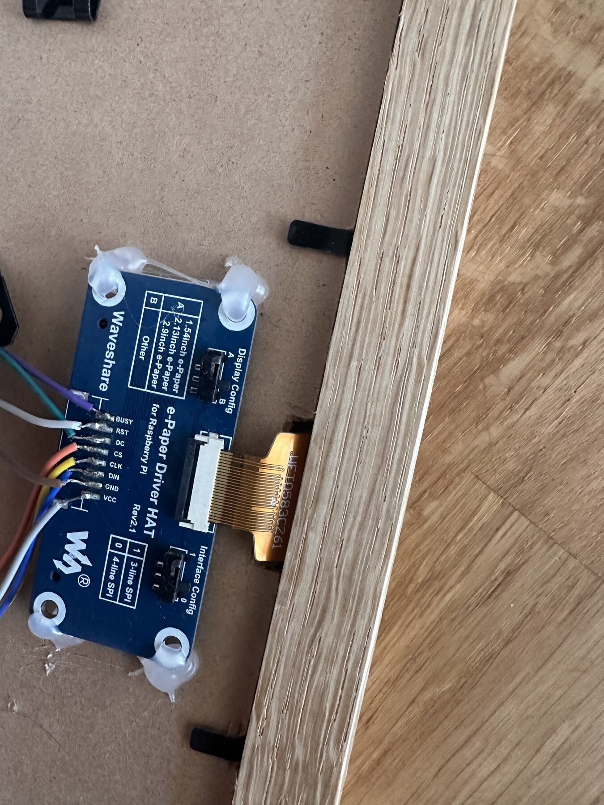
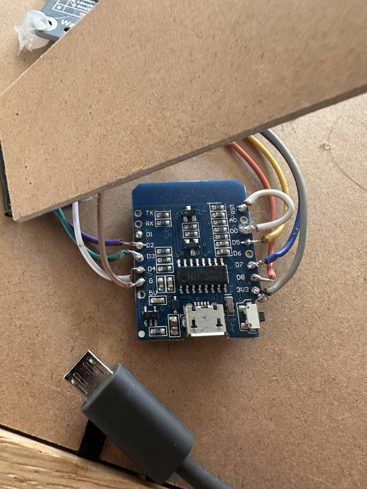

# D1 mini ESP8266 + Waveshare 7.5" V2

> For the same D1 mini connected to the Waveshare 3.52" BW panel, use the
> `d1_mini_35` PlatformIO environment. The HAT wiring below is unchanged. The
> panel is 240x360 natively and the Wignet client uses it in 360x240 landscape
> orientation, matching the validated ESP32 configuration.

This document captures the validated setup for a Wemos/Lolin D1 mini ESP8266
driving a Waveshare 7.5" V2 e-paper panel through the Waveshare e-Paper Driver
HAT.

## PlatformIO Target

Use the `d1_mini_75v2` environment:

```bash
cd esp32
pio run -e d1_mini_75v2
pio run -e d1_mini_75v2 -t upload --upload-port /dev/cu.wchusbserial1440
pio device monitor -p /dev/cu.wchusbserial1440 -b 115200
```

Validated upload details:
- Board detected as `ESP8266EX`
- USB serial bridge: CH340/CH341
- USB VID:PID: `1A86:7523`
- macOS port: `/dev/cu.wchusbserial1440`
- ESP8266 MAC: `02:00:00:00:00:05`
- Expected provisioning AP: `Wignet-0005`

## Wiring

| E-Paper HAT | D1 mini label | ESP8266 GPIO |
|-------------|---------------|--------------|
| VCC         | 3V3           | 3.3V         |
| GND         | G             | GND          |
| DIN         | D7            | GPIO 13      |
| CLK         | D5            | GPIO 14      |
| CS          | D8            | GPIO 15      |
| DC          | D3            | GPIO 0       |
| RST         | D4            | GPIO 2       |
| BUSY        | D2            | GPIO 4       |

Use the table above as the source of truth. The photos below document the
validated soldering layout on the current prototype.

### Soldering Reference

Waveshare e-Paper Driver HAT side:



D1 mini / ESP8266 side:



The D1 mini photo also shows the `D0` / `GPIO16` to `RST` jumper used for
timed deep sleep wakeup.

Waveshare HAT switches:
- Display Config: `B` for the 7.5" panel
- Interface Config: `0` for 4-line SPI

## Bootloader Mode

If upload fails with:

```text
Failed to connect to ESP8266: Timed out waiting for packet header
Invalid head of packet
```

force ESP8266 bootloader mode:

1. Hold `FLASH` / `BOOT`.
2. Press and release `RST`.
3. Keep `FLASH` / `BOOT` held while PlatformIO shows `Connecting...`.
4. Release `FLASH` / `BOOT` when the chip is detected.

If the board has no `FLASH` button, temporarily connect `D3` / `GPIO0` to
`GND`, reset the board, run the upload, then remove the jumper after flashing.

## Boot Pin Warning

ESP8266 boot mode depends on these pins:

| Pin | Required at boot | Current e-paper use |
|-----|------------------|---------------------|
| GPIO0 / D3 | HIGH for normal boot, LOW for flashing | DC |
| GPIO2 / D4 | HIGH | RST |
| GPIO15 / D8 | LOW | CS |

If the display wiring prevents upload or boot, disconnect the e-paper HAT wires
from `D3`, `D4`, and `D8` while flashing, then reconnect them after upload.

## USB Detection on macOS

The bench D1 mini uses a CH340/CH341 USB serial bridge. On MacBook/macOS, the
WCH CH340/CH341 driver is required if the USB device is visible but no serial
port appears under `/dev/cu.*`.

Driver:
https://www.wch-ic.com/downloads/CH341SER_MAC_ZIP.html

Check that macOS sees the board:

```bash
ls /dev/cu.*
pio device list
system_profiler SPUSBDataType | egrep -i "wch|ch34|ch91|cp210|silicon|serial|uart|usb2"
```

Expected CH340/CH341 signals:

```text
/dev/cu.wchusbserial1440
USB VID:PID=1A86:7523
Description: USB Serial
```

If the board powers up but no serial port appears, try a different USB cable.
Charge-only cables were observed to power the board without exposing the serial
device.

## Runtime Notes

After a successful flash, open the monitor:

```bash
pio device monitor -p /dev/cu.wchusbserial1440 -b 115200
```

On first boot, the firmware starts WiFi provisioning if no credentials are
stored. For MAC `02:00:00:00:00:05`, the expected AP name is `Wignet-0005`.

For ESP8266 timed deep sleep wakeup, connect `D0` / `GPIO16` to `RST`.
Without this jumper, the board can enter deep sleep but will not wake itself.
